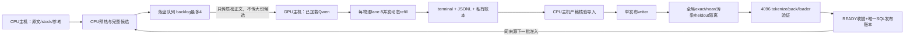

# LLM data curation pipeline — pretraining v144/v146 + SFT acceptance v12/v13

截至 2026-10-09 的 **Qwen FP8 / CPU→GPU→CPU 连续清洗管线**的公开代码快照，供代码审阅与瓶颈分析。

这不是一个新写的概念 demo：v144 的 35 个、v146 的 37 个 Python 控制器/测试文件与所需冻结生产依赖已逐 SHA-256 对照。公开副本仅将私有机器路径和 SSH 别名替换成示例值；[SOURCE_MANIFEST.json](SOURCE_MANIFEST.json) 逐文件记录原始/公开 SHA 和是否属于生产绑定依赖。**原运行目录、冻结代码、已有请求和任务均未修改。**

## SFT 新增链路（2026-10-13）

新增 [SFT 质量/打包/causal-loader 接入代码](packages/sft-acceptance-v13) 和 [流程与验收说明](docs/sft-acceptance-v12-v13.zh.md)。远程 Linux CPU **89 项测试实跑通过**；v12 有限 96 条已审核样本的小批端到端验收已完成：28 条 / 946 assistant targets 物理包验证，68 条 HOLD。它不是全量 SFT READY，不启动学生训练，不恢复旧教师任务。历史预训练快照和所有冻结生产文件保持原样。

```bash
bash tools/run_sft_tests.sh
```

逐文件 SHA 见 [SFT_SOURCE_MANIFEST.json](SFT_SOURCE_MANIFEST.json)。代码公开，真实语料、缓存、账本、评测题库、tokenizer、部署配置及运行授权不公开。

## 最新预训练版本与范围

- **v144 主链路**：[目录](packages/curation-continuous-v144)。代码/技术领域缺口调度，原文预热、压缩传输、独立 GPU 审核、CPU 全门发布。
- **v146 GPU 0 补充链路**：[目录](packages/curation-continuous-v146)。FineWiki 中文单独 scope；严格复核原同教师参考、只读复制，不清旧 HOLD、不重复教师请求。与 v144 共用原库存分配锁和最终单 writer 锁。
- [最新改动与并行边界](docs/current-v144-v146.zh.md) · [v146 并行守卫](packages/curation-continuous-v146/parallel_guard.py) · [领域缺口排序](packages/curation-continuous-v144/deficit.py)
- v131 源码保留用于历史对比，旧 git 提交保留原完整快照。共享依赖目录现在对应最新导出的依赖；不要把当前工作树当成旧版本冻结部署。
- 未发布失败的 v145 准备目录、真实运行授权/配置/输入、私有日志与账本。此更新**不部署、不重启服务器任务**。

## 从哪里开始看

| 入口 | 作用 |
|---|---|
| [prepare.py](packages/curation-continuous-v144/prepare.py) | 库存选择、完整正文读取、heldout、原始质量门、候选预热、落盘队列 |
| [selection.py](packages/curation-continuous-v144/selection.py) | 在 train/validation/test 选择及 LIMIT 前排除旧分配/旧尝试 |
| [primary.py](packages/curation-continuous-v144/primary.py) | 持久传输、结果核验导入、发布队列、**单一发布 writer** |
| [gpu.py](packages/curation-continuous-v144/gpu.py) | 已加载模型复用、逻辑槽位到实际 GPU 的 lane 调度、每来源 READY 反馈门 |
| [engine.py](packages/curation-continuous-v144/engine.py) | 无组 barrier 的动态并发 refill，未知结果停止新增但排空在途 |
| [worker.py](packages/curation-continuous-v144/worker.py) | 请求准入、协议身份、完整正文质检、私有请求账本、实际结果 |
| [receipt_adapter.py](packages/curation-continuous-v144/receipt_adapter.py) | terminal/JSONL/私有 SQL 绑定，READY 的 SQL/证据/物理包 SHA 核验 |
| [p0_qwen_overnight_slot_v67.py](scripts/p0_qwen_overnight_slot_v67.py) | 原始容量门、全流程发布适配及 12 小时单 writer 锁 |
| [p0_release_inventory_batch_qwen_v35.py](scripts/p0_release_inventory_batch_qwen_v35.py) | 全库存去重、隔离、4096 打包、发布收据 |
| [p0_parallel_near_v21.py](scripts/p0_parallel_near_v21.py) | 只读并行 global near 查询与有序 local merge |
| [quality_qwen_v35.py](src/small_agent/curation/quality_qwen_v35.py) | 独立参考、独立来源及个体/滚动样本质量门 |

更多：[结构与数据流](docs/architecture.zh.md) · [实测耗时与瓶颈](docs/performance.zh.md) · [审阅问题清单](docs/review-guide.zh.md)

## 当前实际架构



- 当前 CPU 发布实际计算 workers **4**，GPU QA 每 lane **8**；这是当前配置，不宣称最优并发。
- 发布 writer **1**，后台预热及不同来源 GPU 质检可以重叠；同来源下一批等待当前完整验真 READY。
- `maximum_batches=None`，但 backlog 最大 4，不能因第一批 READY 终止。
- **当前仍在 CPU 主机做最终发布/打包。GPU 主机 CPU 分担打包、最终包存 GPU 主机，是讨论中的优化，尚未实现。**
- 来源通过时可采用原始分层滚动审计大批路线；来源未通过时使用最多 512 篇的逐篇路线。不能把抽样审核描述成逐篇质检或全库事实准确率认证。
- 未知结果、超时、quality/physical HOLD 不自动重试、不清理、不跨来源或教师借分。
- 新 READY 只计 SQL train 文档的正文 token；候选、教师输入、heldout、EOS 不计入新增。

## 范围与未包含内容

包含当前控制器、静态 Python 依赖闭包、原始政策/协议模板、合成 fixture 单元测试和审阅文档。部分旧版本模块是兼容导入依赖，**不代表当前调用 paid DeepSeek 或恢复旧作业**。

不包含：语料/候选原文、模型权重、tokenizer 实物、私有请求账本、运行 SQLite、来源参考实物、评测原题库、运行 CONFIG、机器身份绑定、密钥、账户配置、部署授权、真实 READY/launch intent。

因此这是 **review snapshot，不是可一键启动的生产部署包**。源码内历史配置中的数字目标/并发值也不代表当前运行值；历史 v131 性能字段见 [示例性能配置](examples/PERFORMANCE.v131.example.json)，其中 `goal_ready_train_tokens_per_hour` 是目标而非实测。

## 离线测试

Linux + Python，先在独立环境安装 [requirements-analysis.txt](requirements-analysis.txt)，再运行：

```bash
bash tools/run_current_tests.sh
# 历史小套件：bash tools/run_offline_tests.sh
```

测试只用合成 fixture、临时 SQLite 和 loopback 假服务器，不调用真实教师或训练，不创建/重启 systemd 服务。源码解析、测试和公开源 manifest 校验结果见 [VALIDATION.md](docs/VALIDATION.md)。

生产运行依赖 Linux `/proc`、cgroup v2、systemd user unit、SSH/rsync、独立冻结 tokenizer/库存/参考/评测注册表，以及真实进程身份。不要拿公开模板直接替代现有冻结生产 CONFIG。

## License

代码按原项目 Apache-2.0 许可证发布，见 [LICENSE](LICENSE)。此代码许可证不授予任何未发布语料或模型权重的许可。
