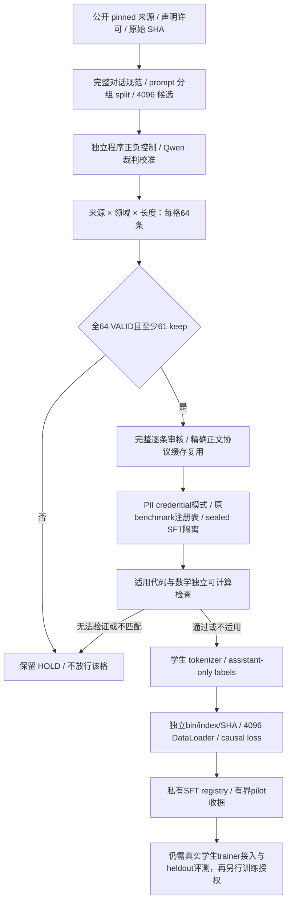

# SFT：独立质量校准 → 有界正式链路接入试验

这条链路与原预训练库存/SQL **分开记账**。它不是新训练任务，也不是将 19,063 条候选一键视为合格。

## 链路顺序



## 当前版本边界

- 公开的旧 v144/v146 仍是预训练审阅快照；未重新部署、未清旧 HOLD。
- SFT 原候选 19,063 条，train 18,089 / validation 606 / test 368。只有 train 参与教师来源审计；验证/测试保持封存。
- 新来源样本 768 条完整结束：753 VALID、15 INVALID；705 keep **不是 705 READY**。
- 三格通过：Alpaca 中文 code short、code medium、general short。其余九格 HOLD，不按剔除失败后的分母降低门。
- v12 接入试验仅每个已通过格确定性选 32 条既有 VALID keep，共 96；精确正文、候选 SHA、原结果 SHA、同裁判完整协议核验后复用，新增教师请求为 0。
- 完整复原原分层切片，包括 `(token_length,id)` 排序和切片边界的同长度 tie；不得以近似 token 区间替代实际成员资格。
- v12 pilot 已实跑远程 Linux CPU 88 项测试，独立 v13 审阅副本追加 nested-return 子集拒绝回归后 89 项测试通过；包含原裁判协议回归、真实 BatchEncoding 计数、mask/pack 篡改检测、真实 PyTorch CPU DataLoader 和 shifted cross-entropy 梯度检查。不是 GPU 性能测试，不加载学生模型或更新权重。

## 代码入口

| 文件 | 职责 |
|---|---|
| `judge.py` | 请求预留、原始响应落盘、证据 grounding、逐条来源审核、多副本绑定与未知结果停止新增 |
| `gold.py` | 程序生成独立正/负合成控制；不是把程序标签发给教师 |
| `math_tools.py` | 有界、题目侧 Fraction 算术；复杂自然数学仍 HOLD |
| `token_count.py` | 实际 `input_ids` 计数；修复旧 `len(BatchEncoding)` 只数 keys 的问题 |
| `sft_adapter.py` | 缓存正文/证据核验、原完整会话格式、labels、4096 collate、causal loss、物理包校验 |
| `code_contracts.py` | 题目 full-match 独立具体输入 oracle + 有界 Python AST 子集解释器；绝不执行任意 Python |
| `pilot_cpu.py` | 原选择完整复原、只读缓存、原 benchmark gate、私有单 writer、有界 pilot 发布 |

`judge.py` 是独立 v12 代码副本，已改接实际 token helper，**没有就地修改或部署冻结 v10**。原错误预检输出也未被悄悄覆盖。新范围必须实际 token 计数，不允许截断来过门。

## 不可省略的限制

1. **代码 correctness 不等于 Qwen 声称正确**：目前程序检查仅支持少数有明确具体输入的 Python sum/sort/max/reverse 契约。其它语言、代码问答、缺失规格、导入/任意属性/exec/while、超预算 AST 均 HOLD。一次具体输入匹配不是全输入正确性证明。
2. general 格没有完整事实 oracle。试验保守隔离数字/自然数学/高风险关键词等无法独立核实的范围；留下的 Qwen 质量审核仍不宣称逐事实权威认证。
3. PII 是明确列出的模式筛查，不是语义 PII 全覆盖证明。benchmark 使用原注册表真实文件 SHA、完整短语/word13/CJK30；不承诺短答案或改写泄漏全检出。
4. 学生格式为 role header → 正文 → end，最后 EOS；system/user/header 不监督，assistant 正文/end 和最后 EOS 监督。完整会话 >4096 HOLD，禁止截断；一个会话一条记录、padding 屏蔽，不把多个会话混装后产生跨样本 loss。
5. 当前 pack 是独立 SFT pilot 格式，**不冒充旧预训练 bin/index loader**。实际学生 trainer 注册、端到端模型 loss/eval 和训练授权还需单独完成。
6. SFT assistant targets 含监督 end/EOS，与预训练 train-body tokens **不能直接相加**。
7. 不导出真实来源正文、私有缓存/SQLite/CONFIG/收据、评测原题、tokenizer 实物、模型权重、机器密钥或部署脚本。运行需要私有的完整冻结输入和当前真实身份验收；公开快照不能一键接管生产。

## 运行离线测试

独立 Linux Python 环境，依赖见仓库 `requirements-analysis.txt`：

```bash
bash tools/run_sft_tests.sh
```

测试用合成文本/临时 SQLite/假 HTTP 响应；不调用真实教师、不启动 systemd、不训练。要在实际数据上使用，必须先绑定完整来源/协议/原始结果 SHA，保留未知和已有失败，独立版本、单次 intent 和真实终态证据缺一不可。

## 实际小批结果与独立审阅修正

v12 96 条 pilot 已完整结束，28 条 general short 完成全部当前 CPU 门、bin/index SHA、SQL 与真实 4096 DataLoader 核验，共 946 assistant supervised targets（含 end/EOS）。其余 68 条 HOLD：64 code 无支持的独立实测结果、4 general 未支持事实/数学范围；没有把代码格通过来源抽样误作逐条代码执行通过。当前 formal SFT READY 仍为 0，学生训练未启动。

公开 v13 是独立 code-only 审阅修正：有界 AST 解释器明确拒绝循环体内 return，避免误模拟 Python 的提前返回；新增一条负例测试，实际 89 项远程 CPU 测试通过。没有在冻结 v12 中修改、没有重发教师、没有重跑旧 pilot；这项修正未在真实代码数据上部署。v12 实际接受包只有 general，没有把该解释器问题影响的数据放行。
